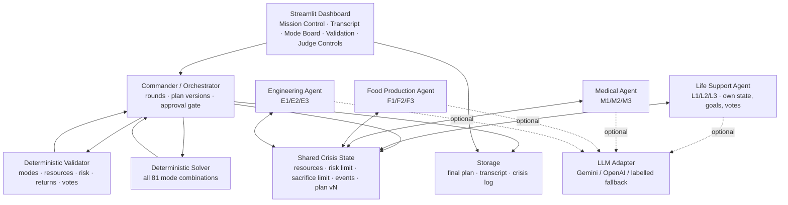

# ARES Accord — Architecture

See `docs/architecture_diagram.png` for the rendered diagram.

## Components and responsibilities

### 1. Deterministic core (no LLM)
- **`packages.py`** — the single source of truth for the 12 fixed mode packages,
  the resource pool, and the risk/sacrifice limits. Values are copied verbatim
  from the challenge guide and never mutated.
- **`validator.py`** — independently recomputes totals, risk, sacrifice count,
  return agreements and votes. Returns a structured `ValidationResult` with a
  per-check pass/fail and human-readable reasons. The Commander cannot bypass it.
- **`solver.py`** — enumerates all `3^4 = 81` mode combinations and returns the
  feasible ones ranked by (fewest sacrifices, lowest risk, protected departments,
  slack). If nothing fits, `infeasibility_report()` returns the least-violating
  plan, the resource shortfalls, and the specific policy change required.

### 2. Agent layer
- **`agents.py`** — `AresAgent` holds role, goals, constraints, memory,
  message history and votes. Four department agents plus role profiles. Every
  decision is produced either by the LLM (structured JSON) or by a deterministic,
  role-specific fallback policy — never a pre-written transcript. All messages
  are appended to the shared transcript and tagged `engine=llm|fallback`.
- **`llm.py`** — one small interface over Gemini and OpenAI, with JSON
  extraction, error classification and total failure isolation. Rate limits
  (HTTP 429), timeouts and connection errors fail over **immediately without
  retrying**; only malformed JSON gets a single retry. Returns `None` rather
  than raising, so callers fall back safely.

### 3. Orchestration layer
- **`commander.py`** — the protocol described in the README: publish crisis,
  proposals, conflict, feasible candidate, returns, votes, approval. Owns plan
  versioning (any change → new version → old votes stale). Enforces a minimum of
  three rounds and the four-matching-votes approval gate, and may activate the
  Crisis Override only when the solver proves it is needed after an event.
- **`engine.py`** — scenario lifecycle: `start()`, `inject_event(raw)`, `reset()`,
  `export()`. On an event it applies resource deltas, marks the approved plan
  STALE/INVALID, expires prior commitments, permits Crisis Override, and
  renegotiates.

### 4. Interface and persistence
- **`app.py`** — Streamlit dashboard (required UI): explicit **OFFLINE/LIVE**
  agent-mode control, a prominent mode banner, per-message provenance badges
  (🟢 LIVE AI / 🔴 FALLBACK / ⚙️ SYSTEM), resource pool, live transcript, mode
  board, validation, votes, plan history, crisis log, exports and judge event
  injection. Defaults to OFFLINE so judging needs no key.
- **`storage.py`** — JSON/CSV exports plus an `output_schema.json`-compatible
  single record for `final_allocation.json`.

## Message flow for one round
1. Commander appends a `STATE` message (round, plan version, numbers).
2. Each department agent independently produces a message (proposal, objection,
   counteroffer, commitment or vote) and appends it to the transcript.
3. The Commander may draft a new numbered plan and ask the validator.
4. The validator's verdict is appended as an `INFO`/`OBJECTION` message.
5. Votes are collected only after a plan passes structural validation.

## Failure handling
| Failure | Behaviour |
|---|---|
| Missing API key | Auto-switch to labelled fallback (LIVE resolves to OFFLINE) |
| Rate limit / quota (HTTP 429) | Fail over **immediately, no retry**; message tagged 🔴 FALLBACK |
| Model timeout / connection error | Fail over **immediately, no retry**; tagged 🔴 FALLBACK |
| Malformed model JSON | JSON extraction, then exactly one retry, then fallback |
| Model output succeeds | Tagged 🟢 LIVE AI (never mixed with fallback) |
| No feasible plan | `INFEASIBLE` + exact blocking constraint + required change |
| No consensus by max rounds | `DEADLOCK` result, transcript preserved |
| Invalid judge event JSON | Dashboard reports the parse error, run continues |
