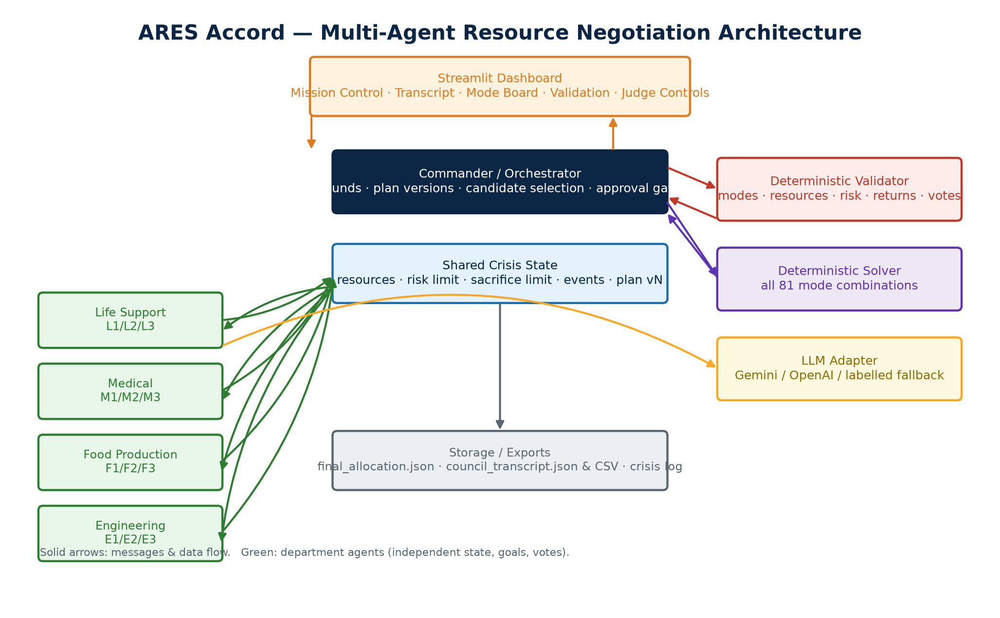

# ARES Accord — Multi-Agent Resource Negotiation for a Mars Colony Emergency

A working, judge-ready multi-agent system: **five independently stateful agents**
(Commander + Life Support + Medical + Food Production + Engineering) negotiate
over a scarce resource pool, a **deterministic Python validator** independently
checks every number, and a **Streamlit Mission Control dashboard** shows the live
transcript, resource state, mode board, validation and voting — with a control to
inject a brand-new emergency without touching code.

> The deterministic core (packages, validator, solver) never calls a language
> model. The LLM only *talks*. So safety is guaranteed even if the model fails.



---

## 1. What it does

| Requirement | Where it lives |
|---|---|
| Five agents with **own goals, state, history, votes** | `ares/agents.py` |
| Real message exchange (proposal / objection / counteroffer / commitment / vote) | `ares/commander.py` + shared transcript |
| Commander controls rounds, plan versions, validation, approval | `ares/commander.py` |
| Deterministic validator (resources, risk, packages, sacrifices, returns, votes) | `ares/validator.py` |
| Feasible-plan search over all 81 mode combinations | `ares/solver.py` |
| Emergency injection + stale plans + renegotiation + fresh votes | `ares/engine.py` |
| Mandatory visual dashboard | `app.py` (Streamlit) |
| JSON / CSV exports | `ares/storage.py`, `exports/` |
| Automated tests for validator + negotiation rules | `tests/` |

### The negotiation protocol (why it satisfies the rules)

1. **Round 1 — Proposals.** Every department requests its preferred mode. The
   Commander drafts plan **v1** with all four Standard packages → validator
   **FAIL** (pool exceeded). *Milestone: a rejected proposal.*
2. **Round 2 — Conflict & concessions.** Departments object with numbers and
   state their maximum concession, and each explicitly **refuses Sacrifice**
   without compensation. Plan **v2** still fails. *Milestone: refusal recorded.*
3. **Round 3 — Feasible candidate & returns.** The Commander adopts the
   deterministic solver's feasible candidate, then two **accepted return
   commitments** are negotiated for the sacrificing department. Plan **v3**
   passes structural validation.
4. **Round 4 — Votes.** All four departments vote on the *same* plan version.
   Only with four ACCEPT votes and a full validator PASS does the Commander
   **APPROVE**. *Any plan change clears earlier votes.*

Minimum of **3 rounds**, at least **1 rejected/revised proposal**, at least
**1 sacrifice refusal**, **2 accepted returns** per sacrificing department, and
**4 matching ACCEPT votes** are all enforced in code and covered by tests.

---

## 2. Fixed scenario values (never relaxed)

Resource pool: **Power 79, Water 52, Oxygen 59, Robot 26, Bandwidth 17.**
Baseline risk limit **24**; Crisis Override **28** and up to **2** Sacrifice modes.

| Dept | Mode | P | W | O | R | B | Risk |
|---|---|---|---:|---:|---:|---:|---:|
| Life Support | L1 / L2 / L3 | 34/27/23 | 10/9/8 | 42/36/33 | 4/6/2 | 4/3/2 | 1/5/9 |
| Medical | M1 / M2 / M3 | 28/21/18 | 12/10/8 | 18/14/12 | 3/2/2 | 10/6/5 | 1/5/9 |
| Food Production | F1 / F2 / F3 | 24/15/10 | 34/27/24 | 8/5/5 | 4/4/2 | 2/2/1 | 1/5/9 |
| Engineering | E1 / E2 / E3 | 26/20/16 | 6/5/4 | 6/5/4 | 22/18/14 | 10/7/5 | 1/5/9 |

The two documented baseline solutions (`L3+M2+F2+E2` and `L2+M2+F2+E3`) are
independently rediscovered by the solver and asserted in `tests/test_solver.py`.

---

## 3. Quick start

Requires **Python 3.10+** (tested on 3.14). Run every command from the project root.

```powershell
# 1. Create and activate a virtual environment
python -m venv .venv
.\.venv\Scripts\Activate.ps1    # PowerShell; on cmd.exe use: .venv\Scripts\activate.bat

# 2. Install dependencies
python -m pip install -r requirements.txt

# 3. (Optional) enable a model. SKIP THIS WHOLE STEP for the reliable offline
#    demo: with no .env the app runs the clearly-labelled deterministic
#    fallback agents and needs no key or network. To use a model instead,
#    copy the example and add GEMINI_API_KEY or OPENAI_API_KEY:
Copy-Item .env.example .env
#    then edit .env and add your key

# 4. Launch the dashboard
python -m streamlit run app.py
```

Open the URL Streamlit prints (usually http://localhost:8501).

### Agent mode: OFFLINE (default) or LIVE
The sidebar has one explicit **Agent mode** control, and the active mode is shown
as a prominent banner at the top of the page:

- **🔒 OFFLINE (deterministic, recommended)** — the default. Pins the
  clearly-labelled rule-based agents. **No key or network is required**, so this
  is the reliable path for judging.
- **🌐 LIVE — Gemini / OpenAI** — asks the configured model to compose messages.
  If no key is present it resolves back to OFFLINE and says so.

> **LIVE is only claimed after a real request succeeds.** A configured key alone
> is *not* enough: the banner says **🟢 LIVE (verified by a real model reply)**
> only once a model call has actually returned usable JSON. If the model is
> selected but every call fails (bad key, no quota, offline), the banner
> honestly reports **🔴 FALLBACK** and every message stays tagged FALLBACK.

### Run with a model
Set `ARES_LLM_PROVIDER=auto` (default) and one key in `.env`:

| Variable | Notes |
|---|---|
| `GEMINI_API_KEY` (or `GOOGLE_API_KEY`) | Google Gemini, default model `gemini-3.5-flash-lite` |
| `OPENAI_API_KEY` | OpenAI, default model `gpt-4o-mini` |

Then select **🌐 LIVE** in the sidebar.

The Gemini model is configurable via `GEMINI_MODEL` in `.env`
(`ares/config.py` defines `DEFAULT_GEMINI_MODEL = "gemini-3.5-flash-lite"`;
removing the override reverts to it). Set
`GEMINI_MODEL=gemini-flash-lite-latest` (or any account-available model) to
fall back to the previously-used model without a code change.

> **Gemini free-tier quota.** The heavy alias `gemini-flash-latest` currently
> resolves to `gemini-3.8-flash`, whose free tier allows only **20 requests per
> day**; once spent, every call returns `429 RESOURCE_EXHAUSTED` and the council
> degrades to the labelled fallback. The low-cost default
> `gemini-3.5-flash-lite` was verified live with a full approved council run;
> like every model it is subject to free-tier limits, and the exact quota error
> is always shown in the LIVE-fallback warning, never hidden.

### Provenance: fallback is never shown as live AI
Every transcript message (and vote) carries its true source:

| Badge | Meaning |
|---|---|
| 🟢 **LIVE AI** | A real model response was parsed and used. |
| 🔴 **FALLBACK** | The agent used its deterministic policy because the model was unavailable, timed out, was **rate-limited (HTTP 429)**, or returned malformed JSON. |
| ⚙️ **SYSTEM** | Commander/validator/system messages (never model output). |

The banner reports the live/fallback/system counts for the run, and a warning
appears whenever LIVE mode falls back. The run never crashes: rate limits,
timeouts, connection errors and malformed replies all degrade to the labelled
fallback instead of retrying forever (a rate limit is **not** retried, because
retrying cannot refill a quota).

---

## 4. Using the dashboard (judge flow)

1. Sidebar → pick **Agent mode** (leave **🔒 OFFLINE** for the reliable path), set the
   resource pool (defaults are the challenge values) → **Start / restart crisis**.
2. Watch **Mission Control** (available / used / reserve), **Council Transcript**
   (filter by scenario, message type, engine), **Mode Board**, **Validation**, **Plans & Votes**.
3. Sidebar → choose a **practice event** or paste any JSON event (unseen scenarios
   supported) → **Inject event & renegotiate**. The old approved plan becomes
   **STALE/INVALID**, prior commitments expire, Crisis Override may activate, and
   the council renegotiates to a new approved plan or a justified **INFEASIBLE**.
4. The **3. Export** sidebar section writes `final_allocation.json`,
   `council_transcript.json`, `council_transcript.csv`, `plans_history.json`,
   `crisis_handling_log.json` and `llm_operations_log.json` (every model call,
   with redacted errors) to `./exports/` automatically after a run, and
   offers download buttons for the transcript and final allocation.
5. To start over, click **Reset everything** in the sidebar — it clears the
   transcript, plans, votes and commitments and returns to the idle state.
6. **Human-in-the-Loop (optional bonus).** Turn on *Human approval required for
   high-risk plans (risk > 20)* in the sidebar. A plan that passed the validator
   and holds four ACCEPT votes is then **held for human sign-off** whenever its
   risk exceeds 20; use **Approve / Reject as human reviewer**. The gate re-runs
   the deterministic validator and the vote check, so a human can never approve
   an unsafe plan or one missing votes.

Event JSON is flexible. All of these work:

```json
{ "event_id": "CRISIS_002", "event_name": "Solar Aftershock", "impact": { "power_reduction": 4 } }
{ "event_id": "CRISIS_003", "event_name": "Relay Interference", "resource_deltas": { "bandwidth": -2 } }
{ "event_id": "CRISIS_004", "event_name": "Solar Flare", "impact": { "power_reduction_percent": 10 } }
{ "event_id": "CRISIS_999", "event_name": "Catastrophic Cascade", "resource_deltas": { "power": -20, "water": -20, "oxygen": -20, "robot": -20, "bandwidth": -20 } }
```

The last example drains the pool and produces a justified **INFEASIBLE** result
(an empty `resource_deltas` object would stay APPROVED, because nothing changes).

For the recorded demo, see the shot-by-shot script in `docs/DEMO_VIDEO_SCRIPT.md`
and the pre-flight checklist in `DEMO_CHECKLIST.md`.

---

## 5. Run the tests

```powershell
python -m pytest -q
```

Expected: **83 passed**. The suite runs with the offline rule-based provider
regardless of any live key in `.env` (see `conftest.py`), so results are fast and
deterministic; live providers are exercised separately and on purpose. The suite covers:
- exact package values and both baseline solutions (`tests/test_packages.py`)
- every validator check and failure mode (`tests/test_validator.py`)
- all **81 solver combinations** (validity, uniqueness, totals, risk), feasibility
  and infeasibility reporting (`tests/test_solver.py`)
- the end-to-end negotiation rules and voting (`tests/test_negotiation.py`)
- event parsing, stale plans, override recovery, INFEASIBLE (`tests/test_events.py`)
- repeated-rejection recovery, vote invalidation, commitment survival (`tests/test_recovery.py`)
- the Streamlit dashboard: start, snapshot, injection, reset, exports (`tests/test_dashboard.py`)
- LLM failure/fallback labelling and export correctness, including that a
  **rate limit and a timeout are not retried** while malformed JSON gets exactly
  one retry, and the provenance badge mapping (`tests/test_reliability.py`)
- dashboard mode switching: default OFFLINE, honest labels, and LIVE-without-key
  gracefully falling back (`tests/test_dashboard.py`)
- the optional Human-in-the-Loop approval gate, including that a human can
  never approve an unsafe plan and that a newly injected emergency invalidates
  an outdated pending review (`tests/test_human_review.py`)
- fresh votes on the recovered plan version after a mid-run emergency
  (`tests/test_events.py`)

---

## 6. Project structure

```
ares/
  packages.py    fixed mode packages + limits (single source of truth)
  models.py      pydantic records: messages, plans, votes, commitments, events
  validator.py   deterministic validation (no LLM)
  solver.py      exhaustive feasible-plan search + infeasibility report
  llm.py         Gemini/OpenAI adapter with safe degradation
  agents.py      five stateful agents + fallback policies
  commander.py   rounds, plan versioning, returns, votes, approval gate
  engine.py      scenario lifecycle, event injection, exports
  storage.py     JSON / CSV export
  config.py      environment-based settings (never hardcodes secrets)
app.py           Streamlit Mission Control dashboard
tests/           pytest suite
scripts/make_diagram.py   regenerates docs/architecture_diagram.png
scripts/generate_evidence.py   regenerates the deterministic evidence/ logs
docs/            architecture diagram, original challenge README, demo video
                 script, team-declaration template, output-schema notes
```

---

## 7. Known limitations

- The fallback agents are deterministic (rule-based). They are a **clearly
  labelled** reliability path, not a simulated transcript; with an API key the
  same agents compose messages with an LLM.
- The LLM, when enabled, chooses modes/votes, but the Commander enforces round
  minimums and the validator decides safety, so the rules hold regardless.
- Single-process, in-memory state (persisted to `./exports`). No database, so
  latency and concurrent users have not been benchmarked.
- Events that crush the pool correctly return **INFEASIBLE** with a required
  policy change rather than inventing a plan.
- Human-in-the-Loop is an **opt-in** gate (sidebar toggle, default off). It is
  enforced by re-running the deterministic validator, so it never bypasses
  safety; it is a human sign-off layered on top of a valid, voted plan.
- `output_schema.json` describes a **different** resource model than the official
  five-resource scenario (it uses `food_rations` and per-agent records). We keep
  the real five-resource model and provide an adapted `output_schema` view in
  `final_allocation.json`; see `docs/OUTPUT_SCHEMA_NOTES.md`. No fictional
  resources were introduced.
- The challenge's `judges_scoring_rubric.md` was referenced by the original README
  but is **not present** in this repository; we did **not** invent scoring
  criteria. See `docs/OUTPUT_SCHEMA_NOTES.md` for the investigation.

---

## 8. Team declaration & attributions

- **Team declaration:** member names, roles, models/APIs, libraries and any
  reused code are declared in `docs/TEAM_DECLARATION_TEMPLATE.md`. We do not
  invent names, roles or results.
- **Models/APIs:** Google Gemini and/or OpenAI (configurable); offline fallback.
- **Libraries:** Streamlit, Pydantic, pandas, python-dotenv, OpenAI SDK,
  Google GenAI SDK, pytest. `matplotlib` is used only by
  `scripts/make_diagram.py` to regenerate `docs/architecture_diagram.png` and
  is deliberately **not** in `requirements.txt` (install on demand).
- **Pre-existing code:** none. All source built for this challenge. The scenario
  rules/packages come from the official challenge guide in this repository.

No secrets are committed. `.env` is git-ignored; `.env.example` contains names only.
